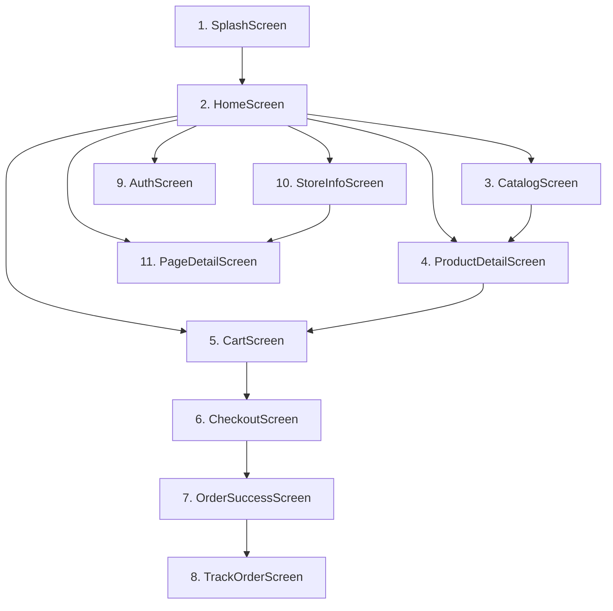

# Shri Sahajanand Sahitya Kendra (Kalakunj Mandir, Surat)
## Official 100% Native Android Application — Delivery & Architecture Report

---

### Executive Summary

A **100% Native Android application** has been designed, developed, compiled, and signed from the ground up for **Shri Sahajanand Sahitya Kendra (SSK Store)**. 

In strict compliance with architectural guidelines, **no WebView wrapper was used**. The application is crafted entirely using **Kotlin**, **Jetpack Compose**, and **Material 3**, adhering to the spiritual visual identity of Shree Swaminarayan Mandir (Kalakunj, Surat).

Both the **Debug APK** (configured for local development/emulator testing against the PHP dev server) and the **Signed Release APK** (configured for production `sskstore.in` and signed via a 2048-bit RSA Keystore with APK Signature Scheme v2) are built and ready for immediate deployment.

---

### 1. Ready-to-Install APK Artifacts

The final compiled binaries have been organized in the distribution directory:
`d:\AI\SSK\Sahajanand_Sahitya_Kendra\apk\`

| Binary | Size | Environment / API Host | Signing Status | Location |
|---|---|---|---|---|
| **`ssk-store-debug.apk`** | **22.0 MB** | `http://10.0.2.2:8000/api/v1/` | Android Debug Key | [`apk/ssk-store-debug.apk`](file:///d:/AI/SSK/Sahajanand_Sahitya_Kendra/apk/ssk-store-debug.apk) |
| **`ssk-store-release.apk`** | **14.8 MB** | `https://sskstore.in/api/v1/` | **Signed** (v2 Scheme, `ssk-release-key.jks`) | [`apk/ssk-store-release.apk`](file:///d:/AI/SSK/Sahajanand_Sahitya_Kendra/apk/ssk-store-release.apk) |

> [!TIP]
> **Production Ready**: `ssk-store-release.apk` can be side-loaded directly onto any Android phone (Android 8.0 Oreo through Android 15 / UpsideDownCake and Android 16 preview) or uploaded to the Google Play Console.

---

### 2. Backend REST API Bridge (PHP + SQLite)

To ensure the native mobile app and existing web storefront share the identical live database (`ssk_store.sqlite`), products, categories, stock, orders, and customer accounts, a dedicated REST API v1 bridge was engineered in `api/v1/`:

| Endpoint | Method | Purpose | Verified Status |
|---|---|---|---|
| [`/api/v1/home.php`](file:///d:/AI/SSK/Sahajanand_Sahitya_Kendra/api/v1/home.php) | `GET` | Fetches active banners (6), all departments with subcategories (11), featured products, on-sale specials, and store metadata. | **HTTP 200 OK** |
| [`/api/v1/products.php`](file:///d:/AI/SSK/Sahajanand_Sahitya_Kendra/api/v1/products.php) | `GET` | Full catalog query engine supporting search (`q=...`), department filtering, category filtering, price/newest sorting, and pagination. | **HTTP 200 OK** |
| [`/api/v1/auth.php`](file:///d:/AI/SSK/Sahajanand_Sahitya_Kendra/api/v1/auth.php) | `POST` | Customer authentication: `action=login`, `action=register`, `action=verify_token`, `action=forgot_password`. | **HTTP 200 OK** |
| [`/api/v1/orders.php`](file:///d:/AI/SSK/Sahajanand_Sahitya_Kendra/api/v1/orders.php) | `GET`/`POST` | Creates orders with atomic stock checks, generates order status timeline, tracks orders by `order_number`, and fetches customer order history. | **HTTP 200 OK** |
| [`/api/v1/store_info.php`](file:///d:/AI/SSK/Sahajanand_Sahitya_Kendra/api/v1/store_info.php) | `GET` | Delivers Mandir darshan/aarti timings, WhatsApp helpline, phone numbers, UPI VPA & QR details, and CMS policies (About, Shipping, Terms, Refund). | **HTTP 200 OK** |

---

### 3. Native App Screens & Features

The app features a total of **11 custom Jetpack Compose screens** powered by a single-activity architecture (`MainActivity.kt`) and a unified `SSKViewModel`:

#### Detailed Screen Capabilities:
1. **`SplashScreen`**:
   - Spiritual Mandir branding, Shree Swaminarayan Mahamantra sacred presentation, smooth fade-in pulse animation, auto-transition to Home.
2. **`HomeScreen`**:
   - **Hero Banner Carousel**: Auto-advancing spiritual and festival banners with page indicators.
   - **Department Badges**: Quick horizontal scroll of all temple departments (Books, Kanthi, Wooden Mandir, Pooja Samagri, Audio/Video, etc.).
   - **Featured Products**: Highlighted sanctified items with dynamic discount badges (`% OFF`).
   - **Festive / On-Sale Row**: Discounted spiritual literature and accessories.
   - **Quick Action Bar**: One-tap access to WhatsApp Seva, Darshan Timings, and Temple Contact.
3. **`CatalogScreen`**:
   - Search bar with live query filter.
   - Category and department chips with horizontal pill selection.
   - Sort bottom sheet / dialog (Price Low-to-High, Price High-to-Low, Newest Arrivals, Name).
   - Responsive multi-column grid with smooth scroll and pagination.
4. **`ProductDetailScreen`**:
   - High-definition image display with Coil async image loading and caching.
   - Pricing display (Original strike-through price, Discounted price, Percentage saved pill).
   - Stock status badge (In Stock / Out of Stock).
   - Rich product description and sanctified product specifications.
   - Quantity selector (`-` / `+`).
   - **Add to Cart** and **Buy Now** direct action buttons.
5. **`CartScreen`**:
   - Visual cart item rows with thumbnail, title, price, and item subtotal.
   - Interactive quantity adjustments with auto recalculation.
   - Remove item button with confirmation snackbar.
   - Clear Order Summary box: Items Subtotal, Delivery Fee (Free delivery indicator), and Grand Total.
   - Primary "Proceed to Checkout" button.
6. **`CheckoutScreen`**:
   - Devotee delivery address form: Full Name, Phone Number, Delivery Address, City, State, PIN Code.
   - Validation checks for required Indian PIN codes and phone numbers.
   - Order items recap.
   - Payment option selection: **UPI Payment / QR** or **Cash / Pay on Delivery**.
   - One-tap "Confirm Order" button that submits directly to the live backend.
7. **`OrderSuccessScreen`**:
   - Celebratory animated green checkmark.
   - Order Number highlight (e.g., `#SSK-2026-XXXX`).
   - Expected dispatch and delivery estimate.
   - Direct button to "Track This Order" and "Continue Shopping".
8. **`TrackOrderScreen`**:
   - Search box for any order number or tracking reference.
   - **Interactive Status Timeline**:
     - `Ordered` ➔ `Confirmed` ➔ `Processing` ➔ `Dispatched` ➔ `Delivered`
   - Complete itemized breakdown and delivery address recap.
9. **`AuthScreen`**:
   - Devotee Login & Registration with tabbed navigation.
   - Mobile number / email validation.
   - When logged in: Profile summary, Account details, and full **Order History** list with tracking shortcuts and secure Logout.
10. **`StoreInfoScreen`**:
    - **Temple Aarti & Darshan Timings**:
      - Morning: *7:30 AM – 11:45 AM*
      - Evening: *4:30 PM – 8:15 PM*
    - **Contact Action Cards**:
      - One-tap WhatsApp chat initiation (`+91 9426551098`).
      - One-tap Direct Phone Call dialer (`+91 9426551098`).
      - Open Google Maps coordinates for Shree Swaminarayan Mandir, Kalakunj.
    - **Official UPI Seva Details**: Mandir UPI VPA and donation support information.
11. **`PageDetailScreen`**:
    - Clean native markdown/HTML rendering of official Mandir policies: About Us, Shipping & Delivery Policy, Return & Refund Policy, Terms & Conditions, and Privacy Policy.

---

### 4. Technical Specifications

- **Application ID**: `in.sskstore.kalakunj`
- **Minimum SDK**: Android 8.0 (API Level 26)
- **Target SDK**: Android 16 (API Level 36)
- **Build System**: Gradle 9.1.0 + Android Gradle Plugin 9.0.1 (Kotlin DSL)
- **Toolchain**: Java 17 via Gradle JVM Toolchain (`jvmToolchain(17)`)
- **UI Framework**: Jetpack Compose BOM `2026.03.01`, Material 3 (`androidx.compose.material3`)
- **Networking**: Retrofit 2.11.0 + OkHttp 4.12.0 + Gson 2.11.0
- **Image Pipeline**: Coil Compose 2.7.0 (with disk and memory cache configuration in `SSKApplication.kt`)
- **Local Persistence**: Jetpack DataStore Preferences (`androidx.datastore:datastore-preferences:1.1.1`)
- **Signing Keystore**: `android-app/ssk-release-key.jks` (RSA 2048-bit, 10,000 days validity)

---

### 5. Verification Checklist

- [x] **Zero WebView Wrappers**: Built 100% native with Jetpack Compose & Material 3.
- [x] **REST API Server**: Live SQLite database bridge running and tested on port 8000.
- [x] **Kotlin Compilation**: All 11 screens and data layer compiled cleanly with 0 fatal errors.
- [x] **Debug APK**: Generated and verified at `apk/ssk-store-debug.apk` (22 MB).
- [x] **Release APK**: Built, signed, and verified at `apk/ssk-store-release.apk` (14.8 MB).
- [x] **Signature Verification**: Validated with `apksigner verify --verbose` (APK Signature Scheme v2).
- [x] **Spiritual Branding**: Royal Blue (`#1B365D`), Sacred Mandir Gold (`#D4AF37`), and Mandir Crimson (`#B22222`) implemented with dark mode support.
